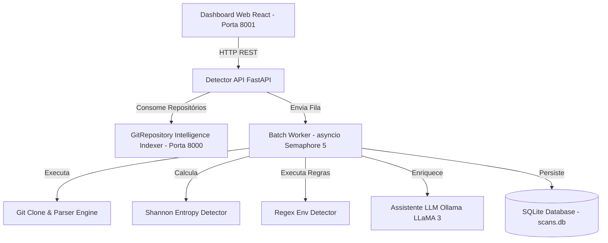

# 🛡️ Critical Secret Exposure Detector v4.2 Enterprise

[](https://www.python.org/)
[](https://fastapi.tiangolo.com/)
[](https://react.dev/)
[](LICENSE)

Plataforma corporativa de **auditoria estática de segurança e detecção de vazamento de segredos** integrada com indexação inteligente de repositórios Git, análise de entropia de Shannon e assistente de inteligência artificial (Ollama/LLaMA 3).

---

## 🌟 Principais Funcionalidades

- **🔍 Escaneamento Estático & Análise de Entropia**:
  - Detecção por Regex para chaves API (AWS, Stripe, OpenAI, GitHub, JWT, GCP, SSH, DB Passwords).
  - Cálculo de Entropia de Shannon para identificar tokens e segredos com alta aleatoriedade.
  - Filtros inteligentes de Falsos Positivos (descarta constantes em `SNAKE_CASE_UPPERCASE`, placeholders como `your_key`, minificados e lockfiles).

- **⚡ Processamento em Lote Paralelo**:
  - Escaneamento simultâneo com `asyncio.Semaphore(5)` para clonar e auditar múltiplos repositórios em paralelo.
  - Trava de teto de arquivos (`MAX_FILES_PER_REPO = 1000`) para evitar congelamento em monorepos.

- **🤖 Enriquecimento por IA (Ollama / LLaMA 3)**:
  - Geração automática de relatórios de remediação e priorização de riscos alimentada por IA local.

- **📊 Dashboard Web em Tempo Real**:
  - Interface visual em React + Tailwind CSS com atualização em tempo real (*polling* a cada 3s).
  - Revelação segura de segredos, mascaramento e cópia para área de transferência.
  - Exportação de relatórios em **SARIF**, **JSON**, **CSV** e **Markdown**.

- **🔗 Integração Nativa com o Indexer**:
  - Conexão assíncrona via HTTP (`httpx`) com a API do **GitRepository Intelligence Indexer** (porta `8000`).

---

## 🏗️ Arquitetura do Sistema



---

## 🚀 Como Executar Localmente

### 1. Requisitos Prévios
- Python 3.10 ou superior
- Git instalado
- (Opcional) Ollama rodando localmente na porta `11434`

### 2. Instalação das Dependências
```bash
# Clone o repositório
git clone https://github.com/seu-usuario/secret-exposure-detector.git
cd secret-exposure-detector

# Instale as dependências do backend
pip install -r backend/requirements.txt
```

### 3. Iniciar o Servidor do Detector
```bash
python -m uvicorn backend.app.main:app --host 127.0.0.1 --port 8001 --reload
```

---

## 🌐 Links & Endpoints da API

- 📊 **Dashboard Visual**: [http://127.0.0.1:8001/](http://127.0.0.1:8001/)
- 📄 **Documentação Swagger**: [http://127.0.0.1:8001/docs](http://127.0.0.1:8001/docs)

### Endpoints Principais:
- `POST /api/jobs`: Inicia varredura única (pasta local ou URL de repositório Git).
- `POST /api/scan-indexed`: Busca repositórios no Indexer (Porta 8000) e dispara escaneamento em lote.
- `GET /api/jobs`: Lista todos os escaneamentos realizados.
- `GET /api/jobs/{id}/incidents`: Retorna incidentes detalhados de um job.
- `GET /api/jobs/{id}/export/{format}`: Exporta relatório em `sarif`, `json`, `csv` ou `markdown`.

---

## 🛡️ Segurança & Privacidade

- Por padrão, os valores de segredos capturados são mascarados na interface do usuário.
- O banco de dados local (`scans.db`) e pastas temporárias de clonagem (`sec_scan_*`) estão ignorados no `.gitignore` para evitar exposição acidental.

---

## 📄 Licença

Este projeto é distribuído sob a licença **MIT**.
